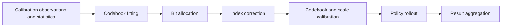

# SACQ — GR00T–LIBERO

SACQ research implementation: structure-aware vector-codebook quantization,
mixed-bit allocation, index correction, and codebook/scale calibration for VLA models.

This repository currently integrates **GR00T–LIBERO**. The numerical core and
model pipeline are available; model checkpoints and simulator assets are external.
The final A8 kernel overlay and recorded experiment map are included as opt-in
research integrations. SimplER, OpenVLA-OFT and AQLM comparisons are not yet
integrated into this release.

## Start here

| Goal | Guide |
|---|---|
| Run the small CPU example | [Installation](#installation) |
| Understand the method and source mapping | [Method map](METHOD_MAP.md) |
| Obtain the calibration set | [LIBERO calibration data](data/libero_calibration/README.md) |
| Set up the model and simulator | [Environment guide](gr00t_libero/ENVIRONMENT.md) |
| Run fitting through evaluation | [Execution runbook](gr00t_libero/RUNBOOK.md) |
| Inspect the recorded SACQ2 configuration | [Reference preset](gr00t_libero/presets/gr00t_libero_sacq2_seed17.json) |
| Match final settings to recorded results | [Experiment map](experiments/gr00t_libero/README.md) |
| Inspect/stage the final A8 kernels | [Acceleration integration](gr00t_libero/acceleration/README.md) |
| Check what has actually been tested | [Validation record](VALIDATION.md) |

## Installation

Use Python 3.10 or later and install PyTorch appropriate for your platform:

```bash
python -m pip install -e .
python -m examples.cpu_pipeline
python -m unittest discover -s tests -v
```

The example and tests use CPU tensors without model weights or a simulator.
The example is a software demonstration, not a paper experiment configuration.
For GR00T execution, use the separate policy and simulator environments described
in the [environment guide](gr00t_libero/ENVIRONMENT.md).

## Pipeline



The pipeline uses explicit input manifests and experiment configurations.
The recorded SACQ2 preset is a reference configuration; it still requires its
external model, candidate-bank and runtime inputs. Follow the runbook rather
than historical defaults in reference source snapshots.

## Repository layout

| Directory | Contents |
|---|---|
| `sacq/` | Numerical fitting, metrics, index correction, reconstruction and packing |
| `gr00t_libero/` | Model adapters, pipeline commands, configurations and pinned source overlays |
| `data/libero_calibration/` | Calibration data description and exact file manifest |
| `reference_sources/` | Research source snapshots for inspection |
| `examples/` | Small standalone example |
| `tests/` | Software tests |
| `tools/` | Source-release and dataset verification tools |

## Calibration data

Original observations were collected periodically during rollouts with a BF16
policy using environment seed **1234**. Requests were randomly selected with
selection seed **0**, matching the count to **640 per suite**, then divided into
**576 training and 64 validation requests**. Each request contains five observations.

The four-suite set contains **2,560 requests / 12,800 observations**, totaling
**5.038 GB** before compression. See the [dataset page](data/libero_calibration/README.md)
for file hashes, layout and download status. Large data files are distributed
separately from Git: [download the four suite archives](https://github.com/haesunglee116/SACQ/releases/tag/calibration-v1).

## Validation and supported scope

The current CPU suite passes 204 tests. The existing real-model validation records a diagnostic
connecting fitting, allocation, index correction, calibration and a 50-episode
rollout. The diagnostic reused an existing candidate bank, fitted one candidate
and performed one calibration update. It is not a complete rerun of all paper
experiments. See [VALIDATION.md](VALIDATION.md) for the tested versions and scope.

The final inference kernel sources, frozen choices and original measurement
identities are included. CPU packaging tests do not revalidate GPU performance:
the relocated A8 overlay requires an existing compatible INT8 bootstrap, and
has not been rerun on a GPU. See the [experiment map](experiments/gr00t_libero/README.md)
and [release notes](RELEASE_NOTES.md).

## Development and distribution

```bash
python tools/release_check.py
python -m pip install build
python -m build
```

The wheel installs the `sacq` numerical package. Use the repository or source
archive for model adapters, tests, examples and calibration manifests.
GitHub Actions defines CPU checks and packaging checks; local test results do
not certify a hosted workflow run.

The original research-code license remains pending. Third-party materials retain
their applicable terms; see [THIRD_PARTY_NOTICES.md](THIRD_PARTY_NOTICES.md).
The recommended owner-license choice is documented in [LICENSE_REVIEW.md](LICENSE_REVIEW.md).
